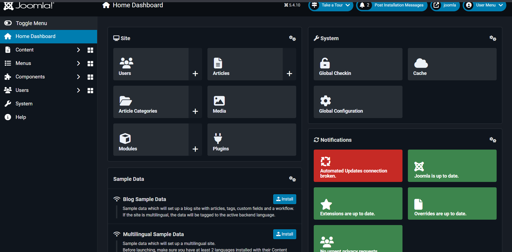
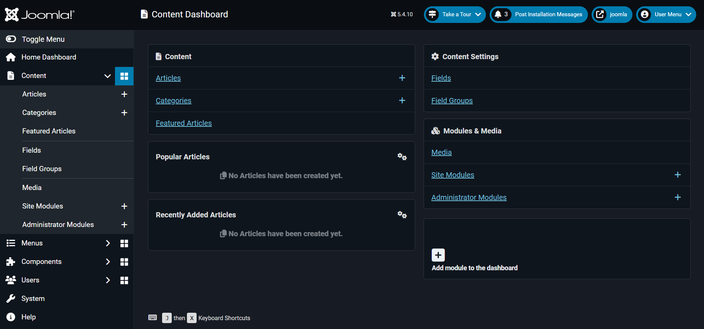
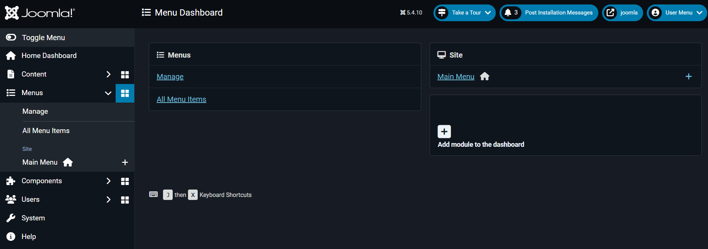
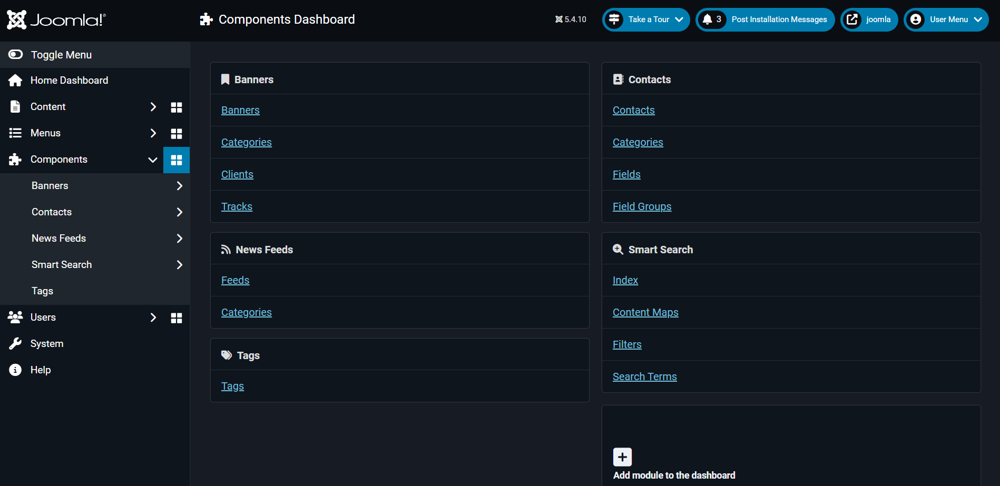
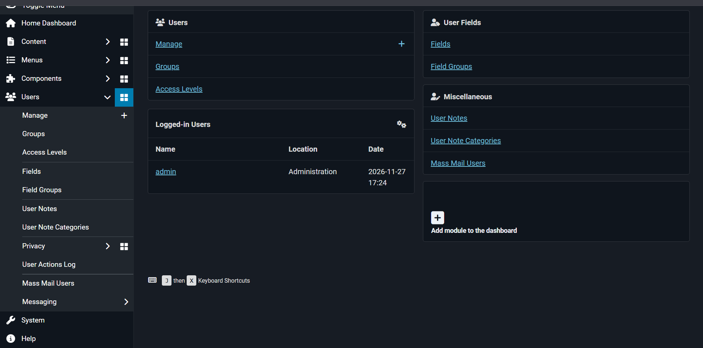
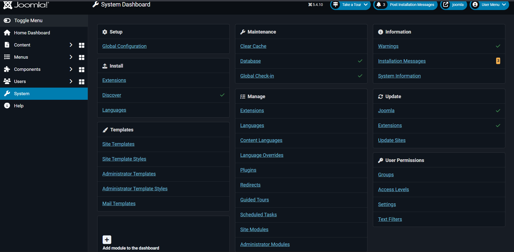
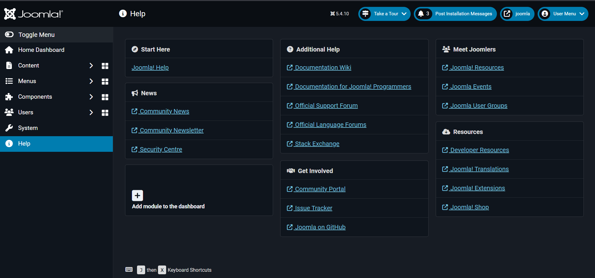

# Semana 7: Panel de administración de Joomla

- **Estudiante:** Anthony Rodríguez
- **Materia:** Software Aplicativo
- **Entorno:** XAMPP (PHP 8.2.12, MariaDB 10.4) + Joomla 5.4.10

---

## Introducción

Joomla es un **CMS** (sistema de gestión de contenidos) que separa el sitio en dos partes:

| Parte | Dirección | Para quién |
|---|---|---|
| Sitio público (*frontend*) | `localhost/my_web` | Visitantes |
| Panel de administración (*backend*) | `localhost/my_web/administrator` | Administradores |

El panel tiene un **menú lateral** con seis secciones. Cada una tiene su propio **tablero** (*dashboard*), que agrupa sus opciones en bloques.

## Panel de inicio (Home Dashboard)

Es la primera pantalla al iniciar sesión. Contiene:

- **Barra superior:** versión de Joomla, recorrido guiado (*Take a Tour*), mensajes post-instalación (*Post Installation Messages*), enlace al sitio público y menú de usuario (*User Menu*).
- **Sitio (Site):** accesos rápidos a usuarios, artículos, categorías, medios, módulos y plugins.
- **Sistema (System):** desbloqueo global (*Global Checkin*), caché (*Cache*) y configuración global (*Global Configuration*).
- **Notificaciones (Notifications):** estado de las actualizaciones, extensiones y solicitudes de privacidad.
- **Datos de ejemplo (Sample Data):** instala contenido de prueba (blog o sitio multilingüe).
- **Actividad:** últimas acciones (*Latest Actions*), usuarios conectados (*Logged-in Users*) y artículos populares y recientes.

---

## 1. Contenido (Content)

Aquí se **crea y organiza el contenido** del sitio.

| Grupo | Opciones |
|---|---|
| Contenido | Artículos (*Articles*), Categorías (*Categories*), Artículos destacados (*Featured Articles*) |
| Ajustes de contenido | Campos (*Fields*), Grupos de campos (*Field Groups*) |
| Módulos y medios | Medios (*Media*), Módulos del sitio (*Site Modules*), Módulos de administración (*Administrator Modules*) |

> Los **módulos** son bloques que rodean al contenido, como el menú o el formulario de inicio de sesión del sitio público.

## 2. Menús (Menus)

Define **cómo navega el visitante** por el sitio.

| Grupo | Opciones |
|---|---|
| Menús | Gestionar (*Manage*), Todos los elementos de menú (*All Menu Items*) |
| Sitio | Menú principal (*Main Menu*) |

> El ícono de casa junto a *Main Menu* indica que ese menú contiene la página de inicio del sitio.

## 3. Componentes (Components)

Son **herramientas adicionales** que amplían las funciones del sitio.

| Componente | Opciones |
|---|---|
| Banners | Banners, Categorías, Clientes (*Clients*), Seguimiento (*Tracks*) |
| Contactos (*Contacts*) | Contactos, Categorías, Campos, Grupos de campos |
| Canales de noticias (*News Feeds*) | Canales (*Feeds*), Categorías |
| Búsqueda inteligente (*Smart Search*) | Índice (*Index*), Mapas de contenido (*Content Maps*), Filtros (*Filters*), Términos de búsqueda (*Search Terms*) |
| Etiquetas (*Tags*) | Etiquetas |

## 4. Usuarios (Users)

Controla **quién accede al sitio y qué puede hacer**.

| Grupo | Opciones |
|---|---|
| Usuarios | Gestionar (*Manage*), Grupos (*Groups*), Niveles de acceso (*Access Levels*) |
| Campos de usuario (*User Fields*) | Campos, Grupos de campos |
| Varios (*Miscellaneous*) | Notas de usuario (*User Notes*), Categorías de notas (*User Note Categories*), Correo masivo (*Mass Mail Users*) |

En el menú lateral también aparecen **Privacidad** (*Privacy*), **Registro de acciones** (*User Actions Log*) y **Mensajería** (*Messaging*).

> Los **grupos** definen qué puede *hacer* un usuario; los **niveles de acceso** definen qué puede *ver*.

## 5. Sistema (System)

Es el **centro de configuración y mantenimiento** del sitio.

| Grupo | Opciones |
|---|---|
| Configuración (*Setup*) | Configuración global (*Global Configuration*) |
| Instalar (*Install*) | Extensiones, Descubrir (*Discover*), Idiomas (*Languages*) |
| Plantillas (*Templates*) | Plantillas y estilos del sitio y de administración, Plantillas de correo (*Mail Templates*) |
| Mantenimiento (*Maintenance*) | Limpiar caché (*Clear Cache*), Base de datos (*Database*), Desbloqueo global (*Global Check-in*) |
| Gestionar (*Manage*) | Extensiones, Idiomas, Plugins, Redirecciones (*Redirects*), Recorridos guiados (*Guided Tours*), Tareas programadas (*Scheduled Tasks*), Módulos |
| Información (*Information*) | Advertencias (*Warnings*), Mensajes de instalación, Información del sistema (*System Information*) |
| Actualizar (*Update*) | Joomla, Extensiones, Sitios de actualización (*Update Sites*) |
| Permisos de usuario (*User Permissions*) | Grupos, Niveles de acceso, Ajustes (*Settings*), Filtros de texto (*Text Filters*) |

## 6. Ayuda (Help)

Reúne **documentación y soporte oficial**. Casi todos son enlaces externos a sitios de Joomla.

| Grupo | Opciones |
|---|---|
| Empieza aquí (*Start Here*) | Ayuda de Joomla (*Joomla! Help*) |
| Noticias (*News*) | Noticias y boletín de la comunidad, Centro de seguridad (*Security Centre*) |
| Ayuda adicional (*Additional Help*) | Wiki de documentación, documentación para programadores, foros oficiales, Stack Exchange |
| Participa (*Get Involved*) | Portal de la comunidad, Seguimiento de errores (*Issue Tracker*), Joomla en GitHub |
| Conoce a la comunidad (*Meet Joomlers*) | Recursos, eventos y grupos de usuarios |
| Recursos (*Resources*) | Recursos para desarrolladores, traducciones, extensiones y tienda |

---

## Conclusión

El panel de Joomla organiza la administración por responsabilidades: **contenido** (*Content*), **navegación** (*Menus*), **funciones extra** (*Components*), **personas** (*Users*), **configuración** (*System*) y **soporte** (*Help*). Gracias a esta organización y a sus tableros, se puede gestionar un sitio completo sin escribir código.